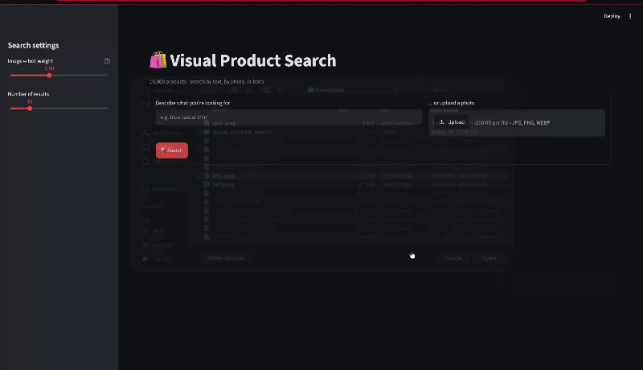

# Visual Product Search

An application for searching a fashion product catalog with:

- A text description, such as `blue casual shirt`
- An uploaded product image
- Both text and image together

The application uses OpenAI CLIP to create query embeddings and FAISS to find visually or semantically similar products.



## Methodology

The project uses a multimodal search process:

1. The product images are converted into numerical vectors using the CLIP model.
2. These vectors are stored in a FAISS index for fast similarity search.
3. A user's text description or uploaded image is converted into a vector using the same model.
4. FAISS compares the query vector with the product vectors and returns the closest matches.
5. Streamlit displays the matching products.

When both text and image are provided, their vectors are combined. The sidebar weight controls how much influence each input has:

- Lower values give more influence to text.
- Higher values give more influence to the image.

## Project structure

```text
visual product search/
├── app.py                         # Streamlit user interface and search flow
├── requirements.txt               # Python dependencies
├── README.md                      # Project documentation
├── src/
│   ├── __init__.py
│   ├── catalog.py                 # Loads the catalog and FAISS index
│   ├── config.py                  # Paths and application settings
│   ├── encoder.py                 # CLIP image/text embedding logic
│   └── search.py                  # FAISS search and result formatting
├── search_visual_product_v1/
│   ├── data/
│   │   ├── image/                 # Product images
│   │   └── products.parquet       # Source product data
│   ├── artifacts/
│   │   ├── catalog_v2.parquet     # Catalog used by the app
│   │   ├── encoded_products.parquet
│   │   ├── image_embeddings.npy
│   │   └── image_index.faiss      # FAISS index used for search
│   └── results/                   # Evaluation outputs and charts
└── search/                        # Local Python virtual environment
```

The `search/` directory is a local virtual environment and is not included in the project files. Create a new environment during installation.

## Requirements

- Python 3.13
- A working internet connection for the first CLIP model download
- The `search_visual_product_v1` data folder

The data folder is stored separately because it contains the product images, catalog files, and search artifacts. Download it from the following shared Google Drive folder and place it in the project root:

**Data download:** [Download the `search_visual_product_v1` folder](https://drive.google.com/drive/folders/1tgwpGKJpe4f0aKEhb8MrBZ_MTviBbzTE?usp=drive_link)

The first run downloads the `openai/clip-vit-base-patch32` model from Hugging Face. The model is cached locally after it is downloaded.

## Installation

Open a terminal in the project directory:

```bash
cd "/Users/rachin/Desktop/visual product search"
```

Create a virtual environment:

```bash
python3.13 -m venv search
```

Activate it on macOS or Linux:

```bash
source search/bin/activate
```

Install the dependencies:

```bash
python -m pip install --upgrade pip
python -m pip install -r requirements.txt
```

Confirm that FAISS is installed in the active environment:

```bash
python -c "import faiss; print(faiss.__file__)"
```

## Run the application

Make sure the virtual environment is active, then run:

```bash
streamlit run app.py
```

If the terminal uses another Python installation, run the project executable directly:

```bash
./search/bin/streamlit run app.py
```

Open the URL shown by Streamlit, normally:

```text
http://localhost:8501
```

## Using the application

1. Enter a product description in the text field, upload an image, or provide both.
2. Use the sidebar to choose:
   - **Image ↔ text weight** when both inputs are used
   - **Number of results**
3. Click **Search**.
4. Review the returned product images, names, types, colors, prices, and similarity scores.

At least one input is required. Supported upload formats are JPG, JPEG, PNG, and WEBP.

## Configuration

Application settings are defined in [`src/config.py`](src/config.py):

- `MODEL_NAME`: CLIP model name. It defaults to `openai/clip-vit-base-patch32`.
- `TEXT_PROMPT`: prompt template used for text queries.
- `DEFAULT_TOP_K`: default number of results.
- `DEFAULT_ALPHA`: default image/text balance.
- `CATALOG_PATH`: catalog Parquet file.
- `ENCODED_CATALOG_PATH`: fallback catalog file.
- `INDEX_PATH`: FAISS index file.

## Limitations

- Search quality depends on the CLIP model and the precomputed catalog embeddings.
- The included application searches the provided catalog; it does not download or add new products.
- A compatible prebuilt FAISS index is required at startup.
- The first model load can take time and requires network access if the model is not cached.
